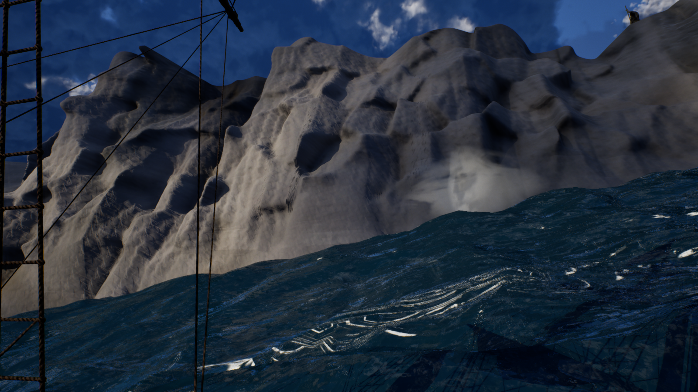
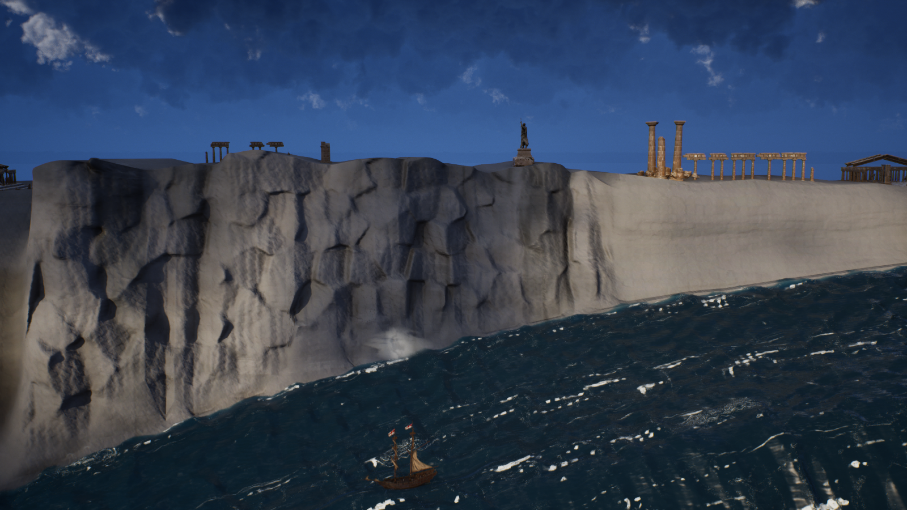

# Cliff surface pass — 15 November

Owner: Codex, `codex/maelstrom-saturday`. This updates the local continuous-cliff demo. The accepted geometry, crater scale and route are unchanged.

The previous atlas redistributed a small scan but retained its recognizable repeated colour pattern. The new material separates whole-cliff geology from small stone detail:

- Unique 4096×2048 colour, roughness and normal maps for the approximately 497 m detailed sector, using the actual geometry's elevation, slope and runoff guides. Bedding terminates within regional exposures instead of painting horizontal lines across the entire mountain.
- A separate unique 8192×2048 map covers the full surrounding ring. Both regional maps clamp. The original FBX V reversal is accounted for when mapping the surrounding terrain.
- The owned Nordic scan supplies only native-scale fractured-stone normal detail. Its broad shape is filtered out. Two differently oriented samples are combined with the unique geological normals; detail slope is capped and attenuated on already-steep faces. No scan basecolour is repeated across the cliff.
- Dry and locally wet areas have different roughness. There is no emissive rock, baked directional shading or new displacement.

## Actual review





The first unique-map pass was too pale and smooth. The second gave the surrounding wall a cobblestone appearance. The third introduced overly sharp scratches from combined steep normals. Those versions were used to identify faults; the final material reduces the procedural facets, limits the detail slope and preserves the non-repeating geology.

This pass addresses surface repetition. The broad cliff still has visibly sculpted recesses and a regular skyline; it is not proof that the entire arena has reached the reference. Old waterfall bindings still belong to a different mesh and remain disabled in this demo. Water, sky, boss and early-game work were not changed by this material pass. Normal gameplay terrain is not replaced by this review-only material setup.

## Reproduction and local inputs

Committed sources:

- `Tools/bake_cliff_geometry_fields.py`: actual accepted-mesh UV surface fields.
- `Tools/bake_cliff_geology.py`: unique detailed-sector geology.
- `Tools/bake_cliff_context.py --fractured`: unique full-ring context.
- `Tools/bake_cliff_detail_normal.py`: measured scan high-pass detail, with BC5-compatible normals.
- `Tools/import_cliff_geology.py`: Unreal texture/material installation.

Current frozen generated folders:

```text
E:/Projects/DirectorsCut/Crater-Workers/Flow-Seams/Saved/CliffGeology/FacetedUniqueV3
E:/Projects/DirectorsCut/Crater-Workers/Cliff-Context-Map/Saved/CliffContext/UniqueRingV2
E:/Projects/DirectorsCut/Crater-Workers/Cliff-Contact/Saved/CliffDetailNormals/NativeMeasuredBC5
```

Set `DC_CLIFF_GEOLOGY_ATLAS`, `DC_CLIFF_GEOLOGY_CONTEXT` and `DC_CLIFF_GEOLOGY_DETAIL` to those respective folders, then run the importer through Unreal's Python commandlet. Each texture is checked against its manifest hash. `Saved/CliffGeologyImport.json` records the active maps, source provenance and material. The existing `Saved/OwnedCliffAtlasImport.json` is updated for the review launcher.

The geometry identity remains source NPZ `87ccac911fdf761c90a0fd790d9a9b283ffd05a5f66ff392c3acfe3a642882d6`, FBX `bee1ee52ca59605037b5fca39314efa92dc0e7a36d5f67a01e888f47415d4d85`. See [geometry and installation prerequisites](CONTINUOUS-SCAN-CLIFF-15NOV.md). Owned scan data and generated assets remain in ignored local folders, not public Git.

Run `Tools/play_continuous_cliff.ps1` for the interactive helm review. The existing offscreen review script now accepts `-RenderCommands` for material-buffer diagnostics.

## Verification and remaining limits

Native material import and shader checks, fixed wide/deck captures, reverse-seek restoration and ending captures are recorded with the final review in `Saved/SceneReview/CliffGeologyFinal*`. These are actual 1600×900 engine screenshots. No new packaged build, main-branch integration or sustained-performance claim is made.

An inherited narrow angular UV-seam strip exists on the opposite side of the full-ring mesh; it is outside these cameras. Atlas endpoint continuity does not correct triangles interpolating across that seam. It should be split during full-ring geometry integration. The current material does not conceal that limitation.
