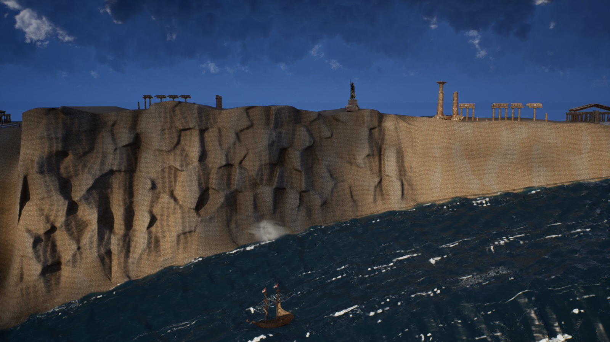
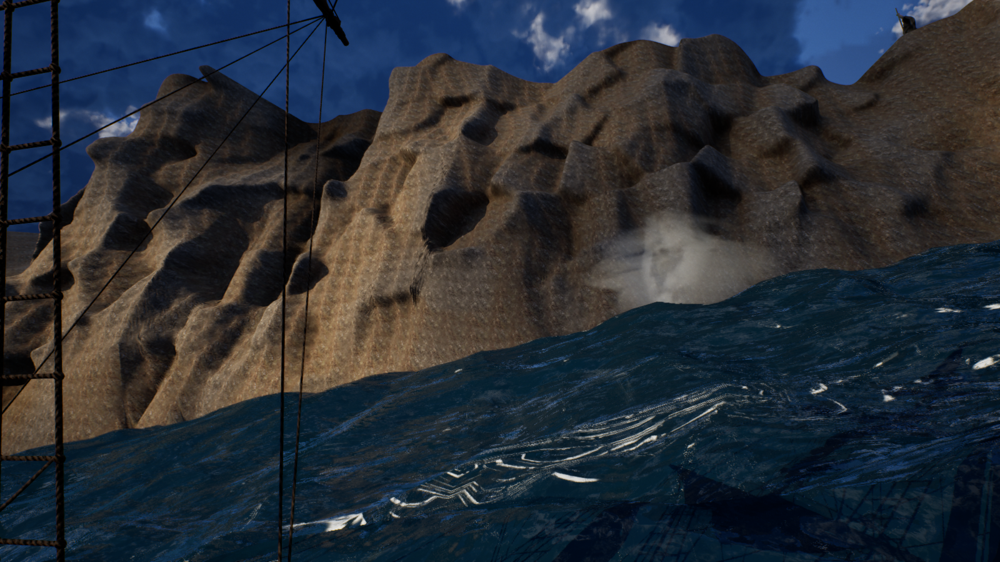

# Continuous scan-derived cliff demo — 15 November

Owner: Codex, `codex/maelstrom-saturday`. Local authoring demo; normal gameplay terrain is not replaced yet.

The stacked Nordic scans were rejected because they made rows of shelves. The replacement is a connected, roughly 497 m cliff sector within the existing crater, using measured scan relief and matching colour, roughness and normal maps. The original scan files remain intact. Owned sources and all derived textures/meshes stay in ignored `Content/LocalScans`, `Content/DC/Maelstrom/GeneratedCliffPreview` and `Saved` directories.

**Delivery status: runnable prototype, not visual approval or a finished arena.** The final actual frames still read as an overly uniform escarpment with synthetic joints. Do not merge this as a finished replacement for the playable scene.





## Delivered source and material

- One connected pilot with preserved original toe/perimeter, broad unequal recesses, crest variation, irregular planar faces and small scan-derived relief. No stacked scan actors are enabled.
- Unique 4096 x 2048 PBR atlas across the pilot. Medium relief is bounded to +/-12 m; fine relief remains about +/-0.53 m. The material retains fine stone scale and broad exposure colours measured from the owned scan. It includes no emissive rock or painted fake cavity shadows.
- Full native mesh: 670,775 vertices and 1,338,156 triangles, imported with Nanite. This includes the surrounding previous full-ring geometry; only the approximately 500 m pilot has the new fractured form.
- Active FBX: `E:/Projects/DirectorsCut/Crater-Workers/Cliff-Contact/Saved/ContinuousScanCliff/FacetedNative/continuous_scan_faceted.fbx`, SHA256 `bee1ee52ca59605037b5fca39314efa92dc0e7a36d5f67a01e888f47415d4d85`.
- Original source: `Cliff-Contact/Saved/ContinuousScanCliff/Faceted/full_ring_candidate.npz`, SHA256 `87ccac911fdf761c90a0fd790d9a9b283ffd05a5f66ff392c3acfe3a642882d6`.
- Current material input: `E:/Projects/DirectorsCut/Crater-Workers/Flow-Seams/Saved/OwnedCliffProjection/vfmjadufa/FinalFacetedExposure`. [Raw-scan extraction, exact dependencies and replay commands](NORDIC-SCAN-UNIQUE-ATLAS-15NOV.md).

## What passed, and what did not

Final source positions, complete triangle connectivity, vertex masks and imported coordinate frame passed the UE source-mesh audit. All 50 ruin groups found support on actual imported triangles. Native 1600 x 900 captures at 300/350 s, reverse seek to 250 s and exit at 451 s completed; no cliff material compilation errors. Existing unrelated EditorToolset/PythonToolset and Pawn startup errors still appear in the project logs; this is not a claim of a clean full-project test.

The regular waffle pattern and blank crest are gone, but the broad cliff still has too even a wall silhouette, some artificial-looking cut faces, and inadequate geological layering/weathering. The neighbouring original terrain remains visibly smoother. The water is also below target. Final frames are evidence of these limitations, not proof of AAA quality. No new long-run performance or packaged-build claim is made.

## First native review: rejected

`Saved/SceneReview/ContinuousScanFirst/shot_0300.png` is an actual Unreal render, not a concept image. It exposes three failures:

- The 7.99 × 5.51 m scan tile repeats roughly 62 times across the face. Repeated displacement creates the waffle shadows; changing colour alone cannot fix this.
- The vertex mask fades the upper cliff to flat neutral material. Arc/height UVs also collapse on a level roof, so the top requires a separate projection or continued surface coordinates.
- The large silhouette remains too regular, with pointed lower flutes and a nearly level crest.

The import itself passed the original source-position, full triangle connectivity and vertex-mask audit. Native rendering, reverse seek to 250 s and ending at 451 s completed. All 50 ruin groups found support on the imported triangles. These technical checks do not imply visual acceptance.

## Remaining integration

The prototype is saved without changing the normal game terrain or boss. Whole-crater rollout, authentic large geological forms, wet/weathered rock response and waterfall contact placement remain unfinished. Existing fitted waterfalls belong to older geometry and are disabled in this demo; do not relabel their source hashes to make them load. Keep the old autonomous scheduler paused. Separate sky/lighting and ACE/voice work remain with their owners.

## Local review

After importing the current mesh/material and preparing its support surface, run:

```powershell
.\Tools\play_continuous_cliff.ps1
.\Tools\review_continuous_cliff.ps1 -ReviewName ContinuousCliff
.\Tools\review_continuous_cliff.ps1 -PlayerView -Shots '305' -ReviewName ContinuousCliffShip
.\Tools\review_continuous_cliff.ps1 -DeckView -Shots '300,305' -ReviewName ContinuousCliffDeck
```

`play_continuous_cliff.ps1` opens an interactive local game at the helm at 295 s, with hazards/voice disabled for this scene review and sound off by default. Look right to inspect the pilot; use `-Sound` for audio. This launcher was syntax-checked; the rendering paths were exercised through the offscreen launcher, not by taking desktop control.

The review launcher uses the installed UE 5.8 game module, renders offscreen without voice or input capture, and saves native-resolution images under `Saved/SceneReview/<ReviewName>`. DeckView is a fixed authoring camera on the ship, not a changed gameplay camera. Neither script rebuilds/packages the game or changes sky ownership. The optional sun-balance flags are supplied by the sky chat.

See [RTX Mega Geometry decision](RTX-MEGA-GEOMETRY-15NOV.md): retain the current Nanite engine for the deadline. Mega Geometry is a ray-tracing technology, not a replacement for good cliff geometry or material authoring.
